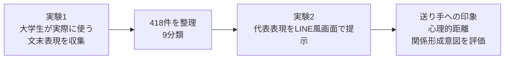

# 1分発表｜LINEのトーク機能における文末感情表現記号が印象形成に及ぼす効果

**四宮 結太郎｜菊池研究室 感性班 B4**

---

## 背景

対面では、**表情・視線・身振り・声の調子**などから相手の印象を形成する。  
一方、LINEではこれらの手がかりが制限されるため、

> **「。」「！」「w」「笑」「😭」「ー」などの文末表現が、送り手の印象を左右するのではないか？**

と考えた。

---

## Research Question

> **LINEのトーク機能において、文末感情表現記号の違いは、関係性の浅い大学生が抱く送り手の印象や関係形成意図にどのような影響を及ぼすか？**

本研究では、文末感情表現記号を、

> メッセージの文末または文末語の語尾に付加され、主要な語彙的内容を基本的に保持しつつ、  
> 受け手に送り手の感情・態度・発話意図・対人的ニュアンス・プロソディー等に関する  
> **付加的な情報を与えうる表記要素**

と定義する。

---

## 研究の流れ

### 実験1
- 大学生 **22名**
- 感謝／謝罪 × 敬語／常体
- **418件**の回答を収集
- 「。」「...」「！」「w」「笑」「絵文字」「長音・語尾付加」等を含む**9分類**に整理

### 実験2
- **感謝／謝罪 × 敬語／常体 × 9条件 = 36刺激**
- LINE風トーク画面を提示
- 性格印象・心理的距離感・関係形成意図を7件法で評価
- 現在、予備実験を実施する段階

---

## この研究で明らかにしたいこと

**大学生が実際に使っている文末表現を出発点として、  
わずかな文末の違いが「この人とどう関わりたいか」まで変えるのかを明らかにする。**

---

<strong>1分発表 原稿</strong>

四宮です。LINEのトーク機能における文末感情表現記号が、送り手への印象形成に与える影響を研究しています。  
対面では表情や視線、声の調子などから相手の印象を形成しますが、LINEではこうした手がかりが少なく、「。」「！」「w」「笑」などの文末表現がその代わりの手がかりになっている可能性があります。  
そこで実験1では、大学生22名から実際に使う文末表現418件を収集し、9つに分類しました。  
実験2では、その分類から代表表現を選び、感謝・謝罪、敬語・常体を組み合わせた36種類のLINE画面を提示します。  
送り手の性格印象、心理的距離、今後も関わりたいかを評価してもらい、文末のわずかな違いが対人印象や関係形成にどう影響するのかを明らかにします。

<strong>発表時に強調する1文</strong>

**「実験1で実際の大学生の使用表現を集め、その結果を実験2の刺激に使う」ことが本研究のポイント。**

