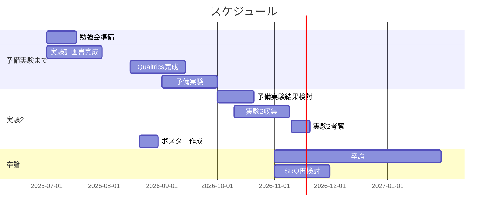

# スケジュール
随時追記


# B4春議事録
## GRQ・SRQ・研究のアプローチ
### GRQ
```
LINEでの感情表現記号が
印象形成に及ぼす影響を明らかにする
```

### SRQ
```
LINEのトーク機能において、LINE特有の
命題内容に寄与しない文末の感情表現記号は
読み手の印象形成にどのような影響をもたらすか？
```

### 研究のアプローチ
- LINEの**文末表現記号の収集**（実験1）
  - 実際に大学生の間で使われている文末表現記号を収集し、分類する。
- LINEの文末表現記号による**印象評価実験**
  - 実際にLINEの文末表現記号を刺激とした印象評価実験を行う。
  - 印象評価実験には7因子を用いる
    - **ビッグファイブ**（外向性、友好性、誠実性、神経質性、開放性）
    - **心理的距離感**
    - **関係形成意図**
      - テキストメッセージにおける印象形成において、読み手に知覚される専門性と真実性によって構成されるコミュニケーターの信頼性は重要であるとされている。

# 第6回GM 11/9
## 進捗
- 卒業研究題目確定届(11/16〆)
  ```
  LINEのトーク機能における文末感情表現記号が印象形成に及ぼす影響
  ```
    - wasedamoodleからの提出
- 予備実験
    - [予備実験について](https://github.com/kikuchiken-waseda/Yutaro_Shinomiya/blob/03e585db61fc53a42a38e221008365d5c0f6d758/B4/%E5%AE%9F%E9%A8%932%E4%BA%88%E5%82%99%E5%AE%9F%E9%A8%93.md)
    - 改善点？は以下に示す
    - [結果](/Users/yutaroshinomiya/.codex/.chatgpt-projects/g-p-6abede1648548191a8b844bd2d2e45cf/outputs/pilot-results/index.html)

## 相談事項・議論メモ
- 予備実験について（以下に示す）

## 予備実験について
<details>

<summary>予備実験についての詳細</summary>

# 予備実験の振り返りと本実験への修正案

研究題目「LINEのトーク機能における文末感情表現記号が印象形成に及ぼす効果」

## 1. 実施概要
- 収集件数 2件（4名に依頼）
- 所要時間
  - 36分52秒、35分05秒

## 2. 条件ごとの評定傾向

- 各参加者について、同じ場面・文体の「記号なし」と比較。
  - 各セルは「上がった回数／下がった回数」で、分母は2名 × 4文脈の8比較。
  - 同点は両方の数から省いた。心理的距離は反転しておらず、低下は距離を感じにくい方向を示す。
  - 8比較は同じ2名の反復であり、記述的な傾向として扱う。

| 文末 | 社交的 | 親しみやすい | 真面目 | 感情的になりやすい | 好奇心が強い | 心理的距離 | またLINEで会話したい |
| --- | --- | --- | --- | --- | --- | --- | --- |
| 記号なし | 基準 | 基準 | 基準 | 基準 | 基準 | 基準 | 基準 |
| `。` | 2／4 | 1／2 | 5／0 | 3／2 | 2／1 | 3／0 | 1／5 |
| `...` | 5／1 | 3／2 | 2／2 | 4／1 | 3／1 | 2／4 | 2／2 |
| `！` | 6／0 | 7／0 | 0／1 | 5／1 | 8／0 | 0／7 | 6／1 |
| `w` | 4／0 | 1／3 | 0／8 | 6／0 | 7／0 | 1／4 | 0／6 |
| `笑` | 5／0 | 1／1 | 0／6 | 6／0 | 5／0 | 0／4 | 1／4 |
| 🙇 | 6／0 | 5／0 | 2／0 | 1／0 | 7／0 | 0／7 | 5／1 |
| 😭 | 6／0 | 5／0 | 0／3 | 4／1 | 6／0 | 0／8 | 6／1 |
| `ー` | 5／1 | 4／2 | 0／6 | 7／1 | 3／0 | 1／7 | 4／2 |

- `！`・🙇・😭
  - 親しみやすさや再会話意向が上がり、心理的距離が下がる比較が多かった。
  - 一方、謝罪・常体の再会話意向は、ある回答者では記号なしが6で、この3条件はいずれも5だった。
- `。`
  - 真面目さが上がるか同点で、再会話意向は下がる比較が多かった。
  - 謝罪・敬語では2名とも真面目さが上がり、再会話意向が下がった。
  - 親しみやすさは同点が5比較あり、一律に冷たく見えたと解釈するには材料が足りない。
- `w`・`笑`
  - 真面目さが下がり、感情的になりやすいという評定が上がる比較が多かった。
  - 謝罪・敬語の `笑` は、再会話意向が一方で5→3、他方で4→5となり、同じ刺激でも読みが分かれた。
- `...`・`ー`
  - 文脈や回答者による違いが見えた。
  - 例えば「ごめん...」の親しみやすさは一方で3→6、他方で5→4だった。
  - `ー` は心理的距離が下がる比較が多い一方で、真面目さも下がる比較が多かった。
- **自己使用傾向**
  - 完了者2名とも感謝に「ありがとう！」を選んだ。
  - 謝罪は「ごめん！」と「ごめん」に分かれた。自身の使用と、受け手としての印象は別の回答として扱う。

## 3. コメントと考察

| 論点 | 確認できたこと | 解釈・追加確認 |
| --- | --- | --- |
| 導入の理解 | 自由記述の要旨に、冒頭の「CMC」が分かりにくい可能性が挙がった。 | 「LINEのトークでのやりとり」と書き、誰の立場で誰を評定するかを明示する。 |
| シナリオ理解 | 相手について同年齢に加え学年も指定してはどうかという提案があった。 | 年齢・学年・親しさの想定が揃っていたかは未確認。同学年を指定するかは対象とする関係に合わせて決め、練習時に相手との関係と会話の経緯を確認する。 |
| 自然さと刺激 | 掲載資料には自然さの直接評定や、特定刺激を不自然とするコメントがない。 | 「申し訳ありませんw」「申し訳ありません笑」「申し訳ありませんー」などは、同年代・同学年という設定や謝罪の重さと組み合わせたときの自然さを点検する。低い真面目さだけで刺激を除外すると、測りたい印象差も失う可能性がある。 |
| 疲労・回答負担 | 完了には約35〜37分を要し、1件は48秒で途中終了した。疲労の直接報告や離脱理由は掲載されていない。 | 252回の反復評定と完了時間は負担を点検する根拠になる。早期終了を疲労の結果とみなす材料はなく、導入・端末操作・離脱理由を分けて確認する。 |
| 順序効果 | 提示順と刺激別所要時間は掲載されていない。評定4・5は一方で111／252件、他方で211／252件だった。 | 尺度の使い方には個人差がある。全体の集中度から、後半の疲労、慣れ、直前刺激との比較は判定できない。 |

親しみやすさと真面目さは同じ方向に動くとは限らない。例えば句点と長音では、真面目さと対人的な近さが別方向に動く比較があった。また、謝罪の「申し訳ありません／ごめん」は敬語・常体に加えて語句自体や謝罪の重さの印象も変わりうる。文体間の違いを文体だけに帰属するには、基底文と場面の点検が必要になる。


- [予備実験について](https://github.com/kikuchiken-waseda/Yutaro_Shinomiya/blob/03e585db61fc53a42a38e221008365d5c0f6d758/B4/%E5%AE%9F%E9%A8%932%E4%BA%88%E5%82%99%E5%AE%9F%E9%A8%93.md)
</details>

### 予備実験改善点
- [ ]　導入とシナリオを修正する。
    - 「CMC」を平易な表現に置き換える。
    - 相手との関係、会話のきっかけ、評定対象をわかりやすく短く示す 
    - 練習刺激を1件用意し、場面理解を短い設問で確認する。
- [ ] 自然さと印象を分けて確認する？
    - 感謝・謝罪のシナリオについて、謝罪の重さや相手との関係の解釈について、意図に沿うか確認すべき？
        - ヒアリングなど
- [ ] そう思わないを1,非常にそう思うを7にすべきだった
  
    - 大体の順番逆じゃないか？
    - 実験でそう思うが1なのが直感とずれてて分析しにくい

## ToDo
- 進捗報告スライド作成
  ```
  進捗報告B:堤、山田、四宮、袴田、西田<15(10+5)分/人 x5人>（ゼミ係：伊丹、高地、陳、内田、深田）
  ```
- 本実験2に向けた準備

# 第5回GM 11/2
## 進捗
- 1分発表
- 実験2予備実験依頼
    - [予備実験Qualtrics](https://wasedaunivcampus.au1.qualtrics.com/jfe/form/SV_9yprf16nLm6fu3c)
- "感情表現記号"の定義
    - 決定版
      ```
      メッセージの文末または文末語の語尾に付加され、
      主要な語彙的内容を基本的に保持しつつ、
      受け手に送り手の感情・態度・発話意図・対人的ニュアンス・プロソディー等に関する付加的な情報を与えうる
      文字・記号・絵文字・顔文字等の表記要素
      ```
    - 稗田（2022）
        - 文末で使用される「句読点」「記号」「絵文字」「顔文字」を総称して「文末絵記号類」としている
        - 声の調子や表情などの情報を補完するほか、送り手の主観的態度や意図、プロソディーなどを伝える機能を持つ可能性
    - Kalman and Gergle（2014）
        - CMCにおいて言語内容を補完する表現を「CMC cues」と呼ぶ
        - 大文字表記、アスタリスク、エモティコン、句読点、文字反復などがその例
        - メッセージを構成する語の字義的意味のみから得られるものではなく、社会的・関係的情報を含む。
        - 特に文字反復は、音声コミュニケーションにおける音の引き伸ばしなどのパラ言語的手がかりを文字上で表現する

## 議事メモ
- 改良点
    - 文末
    - 字義的意味
    - 扱う範囲の網羅性
        - 「記号なし」も感情表現記号に含む
    - 「プロソディ」だけレベルが違う？
- 世代


## Todo
- 予備実験での議論を持ち帰る
    - 可視化しよう

# 第4回GM 10/26
## 進捗
- 合同発表会
    - 合同発表会でもらった指摘の中で特に気になったもの
        - 実験2のシチュエーション
            - 限定的ではないか？
            - 関係形成意図が生まれにくいのではないか？
- 実験2のシチュエーション
    - 元来
      ```
      あなたはAさんと同じ授業で出会いました。
      ──────────────────
      Aさん
      ・あなたと同じ年齢の大学生
      ・あなたと同性
      ・ほぼ初対面の相手
      ──────────────────
      ```
      
    - 最新
      ```
      あなたは大学で新しく所属することになったクラスで、Aさんと知り合いました。
      Aさんはあなたと同じ年齢・同性で、まだほとんど話したことはありません。
      クラスが始まったばかりで、今後も授業やクラス活動などで関わる機会があります。
      最近、クラス内の連絡のためにLINEを交換しました。
      ```
      
## 相談事項
- 実験2のシチュエーションについて
    - **卒論には教示の根拠、検討の過程**にも書いておこう！

## Todo
- 4名に予備実験協力を募る
- 「感情表現記号」の定義
- 要旨提出 11/1〆

# 第3回GM 10/19
## 進捗
- Qualtrics実装（実験2、予備実験用）
    - 提示順の制御
        - 場面の提示順：カウンターバランス
            - 「感謝→謝罪」と「謝罪→感謝」を参加者間でほぼ同数になるように割り付ける
        - 各場面内の刺激提示順：ランダム化
            - 各場面の18刺激（感情表現記号9条件×文体2条件）の提示順を参加者ごとに無作為に決定する
        - 自己使用傾向の質問順：ランダム化
            - 最後の感謝・謝罪に関する2問の提示順を参加者ごとに無作為に決定する
    - 自己使用傾向の測定
        - 目的
            - 感情表現記号を含むメッセージについて、**受け手としての印象評価と、送り手としての表現選択の対応**を探索的？に検討する。
            - 感謝・謝罪の各場面で、**自分が最も使いそうな表現を尋ね**、場面による選択傾向も把握する。
        - 設問構成
            - 感謝・謝罪の場面を用い、各18表現（感情表現記号9条件×文体2条件）から1つを選択してもらう。
        - 根拠
            - 相互に類似したCMC手がかりを使うことが、対人親和性を高めるうえで重要な役割を果たす可能性が示された。
            ```
            Liebman, N., & Gergle, D. (2016, February). It's (Not) simply a matter of time: The relationship between CMC cues and interpersonal affinity. In Proceedings of the 19th ACM conference on computer-supported cooperative work & social computing (pp. 570-581).
            ```

## 相談事項
- 予備実験の人数
    - 4人と想定（カウンターバランスの2パターンの経路を2名に確認してもらう）
    - 予備実験の目的に立ち返る
- 実験計画書に記すのを失念していたのですが、自己使用傾向を入れるのはどうでしょうか...。
- できたらショートプレゼンの練習（本当に時間が余ったらで大丈夫です。）

## ToDo
- 実験2予備実験 4人
- 合同発表会ショートプレゼンpptx提出（10/20〆切）
- SRQを詰める
    - 自己使用傾向の
    - 仮説を立て、仮説通りになるか検証する。
    - 「電子メールと同じ」のように仮説を立てる（なるべくクローズに）

# 第2回GM 10/12
## 進捗
- ポスター修正
    - FBをくださった感性班の皆さんありがとうございました
- 松居研・大須研との合同中間発表会用のショートプレゼン作成
    - 縦横比：4:3
    - 発表時間：1人1分、時間厳守
    - 形式：pptx
- qultricsの訂正

## 相談事項
- 刺激画面
    - 急に「ありがとう」と来ることは少ない（西田）
        - 「ありがとう」の前に何か入れる？
    - 状況を解像度高く伝えること
        - デメリット：内容の固定化、文脈が絞られてしまう
        - 「何を明らかにしたいか」
        - 立場を明示してDF

## Todo
- qualtricsの訂正
    - 敬語・常体
    - カウンターバランス（割り当て注意）
- ポスター・スライド（中間発表報告会）
- 10/22 B4報告会

# 第1回GM 10/5
## 進捗
### LINEトーク画面刺激の妥当性検討
実験2で使用するLINEトーク画面刺激について、
文末感情表現記号以外の要素が印象形成に与える影響を可能な限り統制するため、
場面設定・プロフィール画像・表示名等の設定根拠を検討した。
(夏合宿のポスターセッションを踏まえて)

#### 感謝・謝罪場面と敬語・常体
- 竹原・栗林（2006）は、感謝場面・謝罪場面について、丁寧体・普通体のメッセージで送り手の印象形成への影響を検討している
    ```
  【参考文献】
    竹原 卓真・栗林 克匡（2006）．様々なエモティコンを付加した電子メールが受信者の印象形成に及ぼす効果―感謝と謝罪場面の場合―．*感性工学研究論文集, 6*(4), 83–90．https://doi.org/10.5057/jjske2001.6.4_83
    ```
- 北村・佐藤（2009）でも、携帯メールにおける絵文字の効果とメッセージのフォーマリティとの関係が検討されている。
    ```
  【参考文献】
    北村 英哉・佐藤 重隆（2009）．携帯メールへの絵文字付与が女子大学生の印象形成に与える効果．*感情心理学研究, 17*(2), 148–156．https://doi.org/10.4092/jsre.17.148
    ```
- 本研究でも以下の場面、文体を設定する。(先行研究に倣って)
    - 場面：感謝 / 謝罪
    - 文体：敬語 / 常体

#### 具体的な場面設定
- 竹原・栗林（2006）では「レポート課題」のような詳細なシチュエーションまでは設定されていない。
- Experimental Vignette Methodology（EVM：実験的ヴィネット法）では、一定の具体性を持つシナリオを提示する方法が用いられる。
    - 実際の状況との類似性？や、参加者がその場面の没入度？を高めること
        - 協力者にも想像しやすいような場面設定を心がける
    - 共通した文脈を与える情報は入れるが、研究上必要のない情報は増やさない
        - なるべく簡潔で、印象形成に影響を与えるようなものを考えない
  ```
  【参考文献】
  Aguinis, H., & Bradley, K. J. (2014). Best practice recommendations for designing and implementing experimental vignette methodology studies. *Organizational Research Methods, 17*(4), 351–371. https://doi.org/10.1177/1094428114547952
  ```

- 本研究では、参加者ごとに異なる感謝・謝罪場面を想像することを避けるため、大学生が想像しやすいレポート課題という共通の文脈を設定する。
    - 大学生が想像しやすい
    - 感謝・謝罪が自然に生じる
    - 出来事が重大すぎない
    - Aさんの性格・能力を直接推測させにくい
    - 9種類の文末感情表現記号が極端に不自然にならない

#### プロフィール画像
- オンライン上では、プロフィール画像・アバターの視覚的特徴自体が人物の信頼性や魅力等の印象形成に影響することが示されている。
  ```
  【参考文献】
  Nowak, K. L., & Rauh, C. (2005). The influence of the avatar on online perceptions of anthropomorphism, androgyny, credibility, homophily, and attraction. *Journal of Computer-Mediated Communication, 11*(1), 153–178. https://doi.org/10.1111/j.1083-6101.2006.tb00308.x
  ```

- 顔・性別・趣味等を想起させる情報を減らす目的で、無彩色を基調とした抽象的なプロフィール画像を使用する方向で検討。

## 相談事項

- プロフィール画像は人物情報を減らした無彩色・抽象的なものとする方針でよいか。
- 表示名を「A」とする場合、プロフィールアイコン内にも「A」を表示する必要があるか。
- 文末感情表現記号以外に、LINEトーク画面上で統制すべき要素は他にあるか。


## Todo
- 必要に応じて予備実験で刺激の自然さ・アイコンの印象を確認する
- 刺激仕様確定後、36種類のLINEトーク画面刺激を作成する
